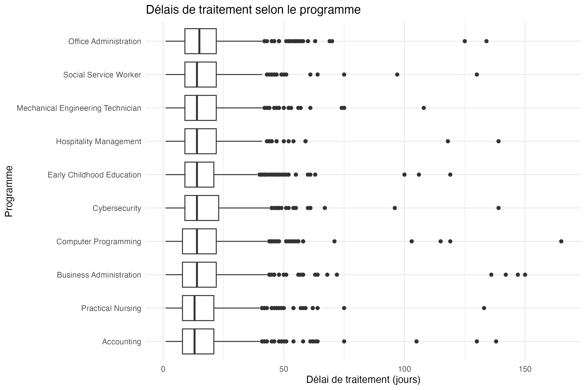

# Suivi statistique des admissions et des inscriptions collégiales

Projet de portfolio simulant un flux récurrent de rapports statistiques pour le bureau des admissions et du registraire d'un collège canadien fictif.

## Objectifs
- Importer et consolider 12 extractions hebdomadaires au format CSV (92 556 observations après dédoublonnage).
- Valider la qualité des données, standardiser les catégories et documenter les anomalies.
- Produire des analyses statistiques descriptives et inférentielles reproductibles sous R.
- Examiner les demandes d'admission, les taux de conversion en inscription, les délais de traitement, les corrélations et les valeurs aberrantes.
- Exporter des jeux de données nettoyés, des tableaux de synthèse et des visualisations prêts pour le reporting.

## Jeu de données
Le jeu de données est entièrement synthétique et fictif. Il ne provient pas de La Cité ni d'aucun établissement d'enseignement réel.

Il comprend 12 extractions hebdomadaires (`weekly_snapshot`) couvrant la période du `2026-08-31` au `2026-11-16`. Chaque extraction présente les demandes reçues jusqu'à cette date ainsi que leur statut à ce moment précis.

Consultez le fichier `data/synthetic_data_dictionary.md` avant l'analyse.

## Structure du dépôt
- `data/raw/` : 12 extractions hebdomadaires au format CSV.
- `data/snapshot_manifest.csv` : dates des extractions et nombre de lignes par fichier.
- `data/synthetic_data_dictionary.md` : définition des champs et mises en garde sur les données.
- `Projet_analyse_statistique_admissions.R` : script R complet et commenté.
- `outputs/` : bases nettoyées, tableaux de synthèse CSV et graphiques PNG exportés.

## Méthodologie et étapes clés (`R` : `dplyr`, `ggplot2`)
1. **Consolidation et nettoyage :** Fusion des 12 extractions, standardisation des marqueurs textuels de valeurs manquantes (`NA`, `NULL`, `N/A`), harmonisation de la casse et suppression de 80 doublons exacts.
2. **Gestion des anomalies et valeurs extrêmes :** Identification des incohérences de statuts et remplacement des délais négatifs par `NA` ; détection des délais exceptionnellement longs (> 38 jours) par la méthode de l'**écart interquartile (IQR)**.
3. **Instantané final par demande (`df_final`) :** Extraction de la dernière observation disponible par `application_id` afin de calculer les indicateurs et taux d'inscription sans double comptage entre les semaines.
4. **Analyses statistiques :** Évaluation de l'association entre le programme et la décision d'admission via le **test du Khi-deux** et le **V de Cramer**, et comparaison des délais moyens par programme via une **ANOVA** à un facteur (avec diagnostic des résidus).

## Aperçu des visualisations

### Répartition des demandes par statut

### Délais de traitement selon le programme

### Évolution hebdomadaire du volume de demandes observées

## Éthique et limites
Toutes les données sont fictives et aucune information réelle sur des étudiants n'est incluse. Ce jeu de données sert uniquement à démontrer des compétences en préparation de données et en analyse statistique ; les associations observées sont synthétiques et ne doivent pas être généralisées à un établissement réel.
