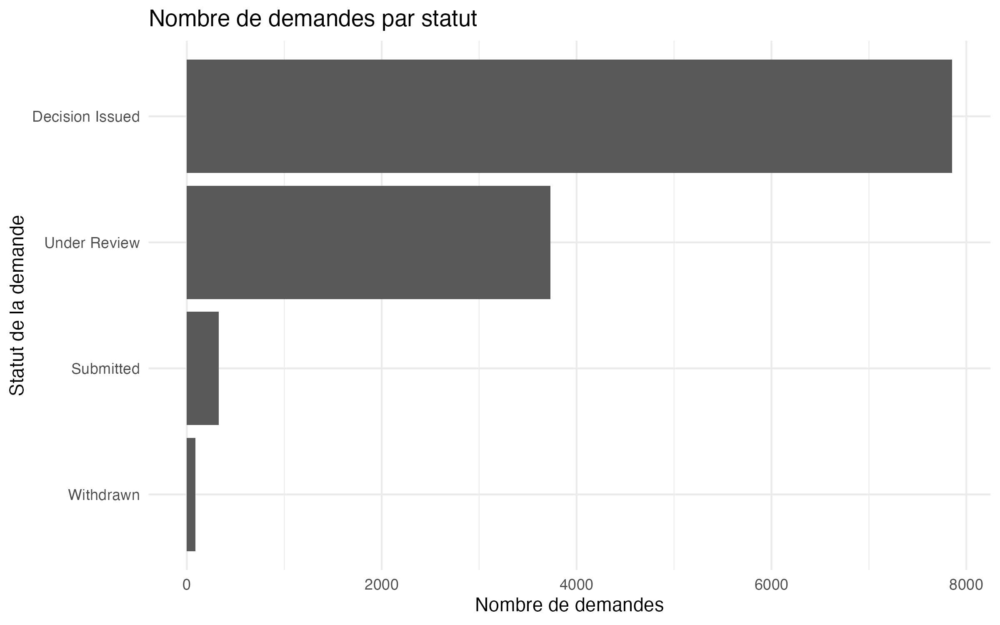
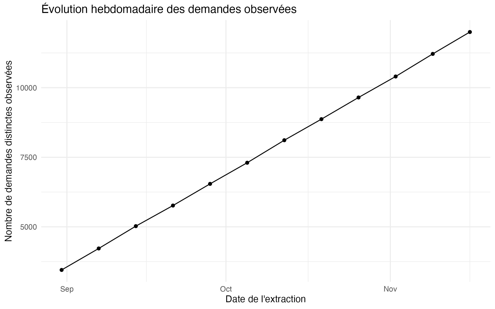

# 📊 Analyse statistique des admissions et inscriptions (R)

Exploration, nettoyage et analyse statistique d'un jeu de données longitudinal portant sur les admissions et inscriptions universitaires/collégiales (12 extractions hebdomadaires du 31 août au 16 novembre 2026).

> **Note :** Les données utilisées sont synthétiques et intègrent des anomalies contrôlées à des fins de démonstration méthodologique.

---

## 🎯 Objectifs du projet
- **Auditer et nettoyer** 12 extractions hebdomadaires (92 556 observations après dédoublonnage).
- **Structurer** les données à deux niveaux : suivi longitudinal (`df`) et état final unique par demande (`df_final`).
- **Analyser** les volumes de candidatures, les taux de conversion (admission → inscription) et les délais de traitement.
- **Tester** statistiquement les écarts observés entre les programmes d'études.

---

## 🛠️ Compétences et outils mobilisés
- **Langage & Packages :** R (`dplyr`, `ggplot2`)
- **Qualité des données :** Standardisation des marqueurs manquants (`NA`, `NULL`, `N/A`), suppression de doublons exacts, harmonisation de casse, détection d'incohérences logiques entre statuts.
- **Gestion des anomalies :** Identification et traitement des délais négatifs, détection des valeurs aberrantes par méthode interquartile (IQR).
- **Statistiques inférentielles :** Test d'indépendance du **Khi-deux** et **V de Cramer** (association programme / décision), **ANOVA** à un facteur et diagnostic des résidus (délais moyens par programme).
- **Data Visualization :** Graphiques comparatifs, histogrammes, boîtes à moustaches (boxplots) et séries temporelles sous `ggplot2`.

---

## 📁 Structure du dépôt

* `data/raw/` : 12 fichiers CSV hebdomadaires bruts
* `outputs/` : Tableaux CSV et graphiques PNG exportés
* `Projet_analyse_statistique_admissions.R` : Script R complet et commenté
* `README.md` : Présentation du projet

---

## 📈 Aperçu des visualisations

### Répartition des demandes par statut

### Délais de traitement par programme

### Évolution hebdomadaire du portefeuille de demandes

